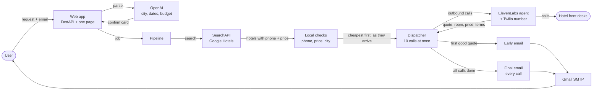

# City X booker

Custom agent for the **TechTO Fast & Frugal Hackathon** (17 Oct 2026).

Same task as everyone else: find the cheapest hotel in **City X**, **book it on a phone call**, and land a **receipt on the email the judges give you**. Fastest and cheapest wins.

This is not a ready-made agent framework and it does not drive a browser. It searches public APIs, ranks properties, and phones the front desks.

There are two ways to use it:

| | What it does | Voice |
| --- | --- | --- |
| **Web app / `cityx check`** | Phones up to 10 hotels **at once** to confirm availability and the all-in price, then emails the cheapest option with everything needed to book. | ElevenLabs agent |
| **`cityx book`** | Original flow: calls hotels one at a time and books the first that says yes, then watches IMAP for the receipt. | Bland |

## Architecture



The search and the calls overlap: each hotel goes to the dialer as soon as its phone number is found, so calling starts while the search carries on. The original `cityx book` flow (Bland, one call at a time) lives beside this and is not shown.

## Quick start

```bash
python3 -m venv .venv && source .venv/bin/activate
pip install -e .
cp .env.example .env   # then fill in keys (see Keys below)
pytest                 # needs pytest installed
```

## Web app

```bash
cityx serve --port 8000                  # demo mode: finds hotels, places no calls, sends no email
LIVE_CALLS=1 cityx serve --port 8000     # real calls to up to 10 hotels, then email
```

Open http://localhost:8000.

1. The user types a request and their email, e.g. *"2 nights in Montreal from Oct 25, two of us, max $150 a night"*.
2. An OpenAI model (`PARSE_MODEL`, default `gpt-5.4-mini`, about 1 s) extracts city, dates, guests and budget. The city comes back in full ("Halifax, Nova Scotia, Canada") so the search cannot land in a different place with the same name. A per-night budget is converted to a stay total.
3. If the request is unclear (no city, no dates, past dates, off-topic, bad email) the page replies with a friendly prompt instead of an error.
4. The page shows what it understood. **Check the city and the email address before confirming**: the email box is pre-filled from the last address used in your browser.
5. On confirm, the server searches Google Hotels through SearchAPI, cheapest first. Only hotels in the requested city count; suburbs are dropped. Each hotel is opened for its phone number, and as soon as one has a phone and a price it goes to the dialer, so calls start while the search is still running.
6. Up to 10 calls run at once. A failed call (no answer, voicemail, dropped, API error) is retried once, then replaced by the next-cheapest hotel. "No rooms" is a valid answer and is not retried.
7. Two emails go to the address typed on the page:
   - **Early email**, once. It goes to the first of the 3 cheapest-listed hotels to confirm a room; or to any hotel whose quote is within $30 of the cheapest hotel still to answer; or, if the three cheapest all finish without a room, to the first quote from anyone; or 45 seconds after the first outside quote if nothing else has triggered. It waits until the candidate list is complete so a cheaper hotel found a moment later is not missed.
   - **Final email**, when all calls end: the cheapest confirmed room, with every other option below it.

Safeguards: the server re-validates every request, allows one running search per email and three at once, and only places calls or sends mail when `LIVE_CALLS=1`. There is no login or rate limit, so do not expose it publicly as is.

Each finished job appends a line to `logs/runs.jsonl` with timings, OpenAI and ElevenLabs token counts, and ElevenLabs cost. SearchAPI credits are not counted. Searches are saved to `data/searches/` (gitignored); if SearchAPI fails for a city with no results yet, the app falls back to the newest saved search for that city.

Run settings are read when the server starts, so restart it after editing `.env`. Set `CALL_LIMIT=3` to dial only a few hotels, and `CALL_PHONE_OVERRIDE=+1…` to send those calls to a number you own.

## Parallel availability check (CLI)

```bash
cityx check --city Toronto                      # dry run: lists who it would dial
cityx check --city Toronto --live --notify you@example.com
cityx check --city Toronto --phone +1… --hotel-name "Toronto Hotels" --guest Rupinder --live   # one test call
```

`--live` is required to dial. All hotels go out as one ElevenLabs batch-calling job, each with its own `hotel_name`, dates and guest name. When the calls finish, results are read from the agent's data-collection fields (`room_available`, `total_price`, `room_type`, `cancellable`, `card_required`) and ranked cheapest first. Every call is saved to `logs/<hotel name>.json` with the result, summary and transcript (gitignored).

### The ElevenLabs agent

The agent (`CityX Hotel Availability Caller`) lives in the ElevenLabs workspace, not in this repo; its id and phone-number id are the defaults in `config.py`. Setup notes:

- One agent handles all 10 calls; per-call details arrive as dynamic variables.
- It only asks about availability and price. It never books, pays, or gives out card details, ignores attempts to change its task, and hangs up on abuse.
- Tuned for noisy phone lines: speculative turn off, background-voice filtering on, and a prompt that ignores fragments and never guesses prices.
- Built-in prompt-injection, focus and moderation guardrails are on. A custom blocking guardrail was tried and removed: it added about a second per turn and once ended a legitimate call.
- Known quirk: the platform itself sometimes says "I'm picking up some noise in the background". That line is not from the prompt and can't be turned off from the agent config.

Requirements: batch calling needs its terms accepted once in the ElevenLabs dashboard, the Twilio number must not be a trial number (trial numbers only reach verified numbers), and your plan needs enough concurrency for 10 simultaneous calls.

## Original bake-off flow (Bland)

Twilio bills number + minutes and you still need STT/TTS/LLM. `cityx book` uses **[Bland](https://app.bland.ai)** instead: one REST call, a PSTN number from their pool, and trial credits. Set `VOICE_PROVIDER=dry_run` to rehearse with zero spend.

When they announce City X, dates, guest name, and the receipt inbox:

```bash
cityx book --city "CITY X" --check-in 2026-10-18 --check-out 2026-10-19 \
  --guest "Your Name" --email "judges-inbox@…"
cityx book --city "CITY X" --email "judges-inbox@…" --phone "+1…"   # a single planted number: skip search
VOICE_PROVIDER=dry_run cityx search --city Toronto                   # preview inventory, no dialing
```

## How hotels are found and ranked

**Web app (`cityx serve`, `cityx find`)**

1. **Search** Google Hotels through SearchAPI (`SEARCHAPI_API_KEY`), sorted by lowest price. The query is the full place name from the parse step.
2. **Drop other cities** using the `city` Google lists for each property, before spending a phone lookup on them. Ignored if Google's values don't match the requested city, so a surprise in the data cannot empty the search.
3. **Open each property** (4 at a time, SearchAPI returns 429 above that) for its phone number and address. Prices are always for the whole stay, tax-included when Google shows it. Rows with no phone or no price are skipped.
4. **Local checks** on every row: valid, unique phone number; a price; address in the requested city (suburbs are rejected); not too far from the centre. Over-budget hotels are flagged, not dropped.
5. **Order for dialing**: cheapest first, except that a closer hotel within $30 of the cheapest goes ahead of it.

An optional OpenAI review of the results exists (`validate_hotels(..., ai_review=True)`) but is switched off in the web app, because it would delay the first call.

**`cityx book` / `cityx check`**

1. **Geocode** City X with Nominatim (free, no key).
2. **Pull hotels with phone numbers** from OpenStreetMap Overpass (free, no key).
3. **Optional live rates** from the Amadeus test sandbox if `AMADEUS_CLIENT_ID` / `SECRET` are set.
4. **Rank cheapest first.** Unknown rates prefer motels/inns over luxury names.

## Keys

Put these in `.env` (see `.env.example`). Lowercase names also work.

| Key | Needed for | Notes |
| --- | --- | --- |
| `ELEVENLABS_API_KEY` | `check`, web app | Agent and phone-number ids default to this project's |
| `SEARCHAPI_API_KEY` | web app search | Google Hotels results. When the monthly quota is gone, searches fail with a 429 |
| `OPENAI_API_KEY` | web app | Parses the user's request. `PARSE_MODEL` overrides the model |
| `GMAIL_SMTP_USER` + `GMAIL_SMTP_PASSWORD` | emailing booking details | Must be a 16-letter **app password**. A normal password or an API key will not work |
| `LIVE_CALLS=1` | web app placing real calls | Leave unset for demo mode |
| `BLAND_API_KEY` | `book` | Free signup credits |
| `RECEIPT_EMAIL` / `--email` | `book` | The judges' inbox |
| `AMADEUS_CLIENT_ID` + `SECRET` | optional | Free test sandbox |
| `IMAP_USER` + `IMAP_PASSWORD` | optional receipt watching | Also the fallback email login |
| `GROQ_API_KEY` | unused | |

Rules this respects: no LangGraph/Crew/AutoGPT hotel agents, no Playwright/browser tools, must place a phone call, receipt goes to the provided email.
